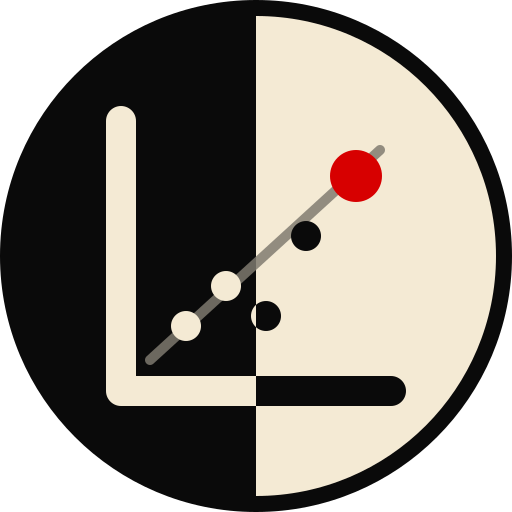

<a id="top"></a>

<div align="center">

<picture>
  <source media="(prefers-color-scheme: dark)" srcset="https://raw.githubusercontent.com/voaneves/Data-Visualization-in-Python-freeCodeCamp/main/assets/logo/logo-dark.svg" />
  <source media="(prefers-color-scheme: light)" srcset="https://raw.githubusercontent.com/voaneves/Data-Visualization-in-Python-freeCodeCamp/main/assets/logo/logo-light.svg" />
  
</picture>

<h1>Data Visualization in Python (freeCodeCamp)</h1>

<p>
  <strong>Notebooks que analisam e visualizam dados com Python, em projetos da freeCodeCamp.</strong><br />
  <sub>Cinco notebooks com pandas, NumPy, matplotlib, seaborn e SciPy</sub>
</p>

<p>
  <a href="https://voaneves.github.io/Data-Visualization-in-Python-freeCodeCamp/"><picture><source media="(prefers-color-scheme: dark)" srcset="https://raw.githubusercontent.com/voaneves/Data-Visualization-in-Python-freeCodeCamp/main/assets/buttons/landing-dark.svg" /></picture></a>
  <a href="https://github.com/voaneves/Data-Visualization-in-Python-freeCodeCamp#notebooks"><picture><source media="(prefers-color-scheme: dark)" srcset="https://raw.githubusercontent.com/voaneves/Data-Visualization-in-Python-freeCodeCamp/main/assets/buttons/notebooks-dark.svg" /></picture></a>
</p>

<p><sub>Precisa de algo assim? <a href="https://voaneves.com/#contato"><strong>Vamos conversar →</strong></a></sub></p>

<p>
  <a href="https://github.com/voaneves/Data-Visualization-in-Python-freeCodeCamp/blob/main/LICENSE"></a>
  
  <a href="https://github.com/voaneves/Data-Visualization-in-Python-freeCodeCamp/issues"></a>
</p>

<p>
  <a href="#sobre-o-projeto">Sobre</a> ·
  <a href="#notebooks">Notebooks</a> ·
  <a href="#como-rodar">Como rodar</a> ·
  <a href="#aprendizados">Aprendizados</a> ·
  <a href="#contato">Contato</a>
</p>

</div>

<picture>
  <source media="(prefers-color-scheme: dark)" srcset="https://raw.githubusercontent.com/voaneves/Data-Visualization-in-Python-freeCodeCamp/main/assets/brand/rule-dark.svg" />
  <source media="(prefers-color-scheme: light)" srcset="https://raw.githubusercontent.com/voaneves/Data-Visualization-in-Python-freeCodeCamp/main/assets/brand/rule-light.svg" />
  
</picture>

## Sobre o projeto

Soluções em Jupyter Notebook dos cinco projetos do curso **Data Analysis with Python** da [freeCodeCamp](https://www.freecodecamp.org/), feitas como estudo.

Análise e visualização de dados com Python, pandas, NumPy, matplotlib e seaborn. Cada notebook tem um badge para abrir direto no Google Colab.

## Notebooks

| Notebook | O que faz | Bibliotecas |
| :--- | :--- | :--- |
| `boilerplate_demographic_data_analyzer.ipynb` | Analisador de dados demográficos: contagem por raça, idade média, percentuais por escolaridade e renda a partir de `adult.data.csv`. | pandas |
| `boilerplate_mean_variance_std_freecodecamp.ipynb` | Recebe 9 números, monta uma matriz 3x3 e calcula média, variância, desvio padrão, máximo, mínimo e soma por eixo. | NumPy |
| `boilerplate_page_views_time_series_visualizer.ipynb` | Visualizador de séries temporais das visitas diárias ao fórum da freeCodeCamp (`fcc-forum-pageviews.csv`), com limpeza de outliers por quantis e gráficos de linha. | pandas, matplotlib, seaborn |
| `boilerplate_sea_level_predictor.ipynb` | Preditor do nível do mar: gráfico de dispersão (`epa-sea-level.csv`) e retas de regressão linear projetadas até 2050. | pandas, matplotlib, SciPy (`linregress`), NumPy |
| `bolierplate_medica_data_visualizer.ipynb` | Visualizador de dados médicos (`medical_examination.csv`): coluna de sobrepeso, normalização de colesterol e glicose, gráfico categórico e matriz de correlação. | pandas, seaborn, matplotlib, NumPy |

## Como rodar

Pelo Colab, use o badge no topo de cada notebook. Localmente:

```bash
gh repo clone voaneves/Data-Visualization-in-Python-freeCodeCamp
cd Data-Visualization-in-Python-freeCodeCamp
pip install pandas numpy matplotlib seaborn scipy jupyter
jupyter notebook
```

Os arquivos CSV usados (`adult.data.csv`, `fcc-forum-pageviews.csv`, `epa-sea-level.csv`, `medical_examination.csv`) não estão neste repositório; baixe-os dos projetos de boilerplate da freeCodeCamp e coloque na mesma pasta do notebook.

## Aprendizados

Manipulação e limpeza de dados com pandas, operações vetorizadas com NumPy, regressão linear com SciPy e gráficos estatísticos com matplotlib e seaborn.

## Licença

A licença MIT em [LICENSE](LICENSE) cobre apenas as soluções do autor. Os enunciados dos projetos e o código base (boilerplate) vêm da certificação "Data Analysis with Python" da freeCodeCamp; os repositórios originais do boilerplate não declaram licença, e todos os direitos desse material permanecem com a freeCodeCamp.

## Contato

<p>
  <a href="https://voaneves.com/#contato"><picture><source media="(prefers-color-scheme: dark)" srcset="https://raw.githubusercontent.com/voaneves/Data-Visualization-in-Python-freeCodeCamp/main/assets/buttons/hire-dark.svg" /></picture></a>
  <a href="https://voaneves.com/"><picture><source media="(prefers-color-scheme: dark)" srcset="https://raw.githubusercontent.com/voaneves/Data-Visualization-in-Python-freeCodeCamp/main/assets/buttons/site-dark.svg" /></picture></a>
</p>

<a href="https://linkedin.com/in/voaneves">LinkedIn</a> · <a href="mailto:victorneves478@gmail.com">E-mail</a>

<p align="center">
  
</p>

<p align="center"><sub>Distribuído sob a <a href="https://github.com/voaneves/Data-Visualization-in-Python-freeCodeCamp/blob/main/LICENSE">Licença MIT</a>.</sub></p>

<p align="center"><sub><a href="#top">↑ Voltar ao topo</a></sub></p>
